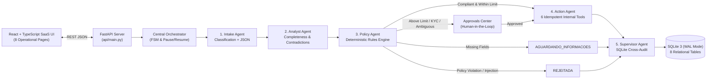
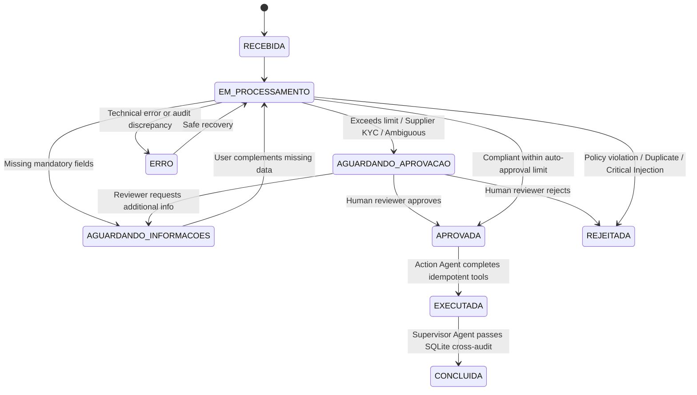

# 🧭 FlowPilot AI
### Intelligent Multi-Agent Orchestration Platform for Enterprise Administrative Operations


---

## 1. Overview
**FlowPilot AI** is an AI engineering portfolio project that automates, validates, governs, and audits administrative workflows (purchase requests, expense reimbursements, supplier onboarding, document issuance, and internal inquiries) through a coordinated pipeline of **five specialized agents** governed by a **Finite State Machine (FSM)**.

Rather than functioning as a conversational chatbot, **FlowPilot AI** operates as a structured operational engine: it parses unstructured requests into strict **Pydantic v2** JSON contracts, enforces deterministic corporate policies isolated from LLM outputs, holds high-risk operations for **Human-in-the-Loop (HITL)** approval, executes internal tools with **SHA-256 idempotency**, and performs a **database cross-audit** before completing any workflow.

---

## 2. Business Problem
Organizations receive dozens of daily administrative requests scattered across emails, forms, and messages. Manual triage and processing frequently lead to:
- **Rework and delays** caused by missing mandatory fields (e.g., reimbursement requests without fiscal receipts or supplier registrations missing tax IDs).
- **Misclassification and routing errors** across departments.
- **Compliance and financial governance risks** when purchases or reimbursements bypass standardized approval thresholds.
- **Lack of auditability**, duplicate executions, and no visibility into operational bottlenecks.

---

## 3. Solution Objective & Key Features
**FlowPilot AI** centralizes administrative operations into a modern B2B SaaS web interface (`React + TypeScript`) backed by a `FastAPI` REST server and a persistent `SQLite` database:
- **5-Agent Structured Pipeline**: Dedicated agents for intake, completeness/consistency analysis, deterministic policy enforcement, idempotent tool execution, and SQLite cross-auditing.
- **9-State Finite State Machine (FSM)**: Explicit lifecycle management with pause and resume support for missing information (`AGUARDANDO_INFORMACOES`) and human governance (`AGUARDANDO_APROVACAO`).
- **Deterministic Local Mode + Optional LLM Mode**: Runs 100% offline/deterministically out of the box without any external API keys, while supporting optional live integration with **OpenAI** and **Google Gemini** REST APIs with automatic fallback.
- **8 Interactive SaaS Pages**: Executive Dashboard, Requests Center, Agents & Telemetry Center, Execution Monitor (step-by-step timeline), Approvals Center (HITL), Agent Evaluation Lab (32 synthetic benchmark cases), Analytics & Impact Simulator, and Settings & Policy Editor.
- **CSV & Executive PDF Exports**: Real-time generation of audit spreadsheets (`UTF-8-SIG`) and formatted executive PDF reports (`fpdf2`).

---

## 4. Engineering Highlights

- **Multi-Agent Orchestration (`orchestrator/workflow.py`)**: Coordinates five specialized agents passing strongly typed Pydantic v2 contracts (`IntakeResult`, `AnalystResult`, `PolicyResult`, `ActionResult`, `SupervisorResult`) with step-level telemetry persisted in `processing_steps`.
- **Finite State Machine (`orchestrator/state_manager.py`)**: Governs 9 explicit states (`RECEBIDA`, `EM_PROCESSAMENTO`, `AGUARDANDO_INFORMACOES`, `AGUARDANDO_APROVACAO`, `APROVADA`, `REJEITADA`, `EXECUTADA`, `ERRO`, `CONCLUIDA`) and raises `InvalidStateTransitionError` on illegal transitions.
- **Human-in-the-Loop Governance (`agents/policy_agent.py` & `api/main.py`)**: High-value purchases (`> R$ 2,500.00`), executive escalations (`> R$ 25,000.00`), supplier KYC, and ambiguous requests are paused in `AGUARDANDO_APROVACAO`. No tool in `ActionAgent` can execute until a human decision is recorded in the `approvals` table.
- **Deterministic Policy Validation (`agents/policy_agent.py`)**: Financial limits and compliance rules are stored in SQLite (`policy_rules`) and evaluated by deterministic Python logic, ensuring user prompts can never alter or bypass corporate thresholds.
- **Idempotency (`services/security_service.py` & `database/repository.py`)**: Every internal tool execution computes a deterministic SHA-256 key (`IDEMP-<hash>`) from `(request_id, tool_name, action_type)`, enforced by a `UNIQUE` constraint in `actions_performed` to prevent duplicate actions during retries or workflow resumption.
- **Prompt Injection Defense (`services/security_service.py`)**: Two-layer inspection (`analyze_security_signals`) combining 17 critical bilingual regex patterns (`critical_flags`) with contextual heuristic detection (`suspicious_flags`), while avoiding false positives on legitimate business text and preserving the original input for audit.
- **SQLite Cross-Audit & Audit Logging (`agents/supervisor_agent.py`)**: Before marking any request as `CONCLUIDA`, the `SupervisorAgent` queries the SQLite database directly to verify that all required steps were recorded, in-memory outputs match persisted records, human approvals were respected, and idempotency keys are intact. All events are logged in `audit_logs` with secret redaction (`mask_sensitive_data`).
- **Automated Evaluation (`services/evaluation_service.py`)**: Built-in **Agent Evaluation Lab** that runs a 32-case synthetic benchmark suite in an isolated temporary SQLite database, computing classification accuracy, extraction accuracy, policy compliance, false positives/negatives, and a multiclass confusion matrix.
- **Optional LLM Integration (`services/llm_service.py`)**: Supports OpenAI (`Authorization: Bearer`) and Google Gemini (`x-goog-api-key` header) with JSON schema instructions, configurable timeouts, retries, and safe fallback to the local deterministic engine on network or parsing errors.

---

## 5. System Architecture



---

## 6. Responsibilities of the Five Agents

| Order | Agent | Source File | Primary Responsibility | Output Contract |
| :---: | :--- | :--- | :--- | :--- |
| **1** | **Intake Agent** | [`agents/intake_agent.py`](agents/intake_agent.py) | Inspect security signals, classify request category, compute confidence, and extract structured entities into JSON without inventing missing values. | `IntakeResult` |
| **2** | **Analyst Agent** | [`agents/analyst_agent.py`](agents/analyst_agent.py) | Check mandatory fields per category, detect numerical contradictions between text and form data, validate tax IDs (CNPJ/CPF), and flag duplicate active requests. | `AnalystResult` |
| **3** | **Policy Agent** | [`agents/policy_agent.py`](agents/policy_agent.py) | Evaluate deterministic rules from SQLite (`RULE_PURCHASE_LIMIT` at `R$ 2,500`, `RULE_PURCHASE_CRITICAL_CAP` executive escalation at `R$ 25,000`, `RULE_REIMBURSEMENT_RECEIPT`, `RULE_REIMBURSEMENT_LIMIT` at `R$ 800`, `RULE_SUPPLIER_MANDATORY_KYC`). | `PolicyResult` |
| **4** | **Action Agent** | [`agents/action_agent.py`](agents/action_agent.py) | Execute internal tools (`create_internal_task`, `organize_pending_items`, `generate_summary_document`, `generate_formal_response`, `prepare_notification_draft`, `generate_processing_report`) with RBAC and SHA-256 idempotency. | `ActionResult` |
| **5** | **Supervisor Agent** | [`agents/supervisor_agent.py`](agents/supervisor_agent.py) | Query SQLite tables directly to cross-audit in-memory results against persisted steps, actions, and approvals; block completion (`ERRO`) if any inconsistency is found. | `SupervisorResult` |

---

## 7. Multi-Agent Processing Flow & Finite State Machine



---

## 8. Technology Stack

- **Frontend (`frontend/`)**: React 18, TypeScript, Vite, Tailwind CSS, TanStack Query (`@tanstack/react-query`), React Router v6, Recharts, Lucide React.
- **Backend (`api/`, `agents/`, `orchestrator/`, `services/`, `tools/`)**: Python 3.11+, FastAPI, Uvicorn, Pydantic v2, `httpx`, Pandas, `fpdf2`.
- **Database (`database/`)**: SQLite 3 (`WAL` journal mode, `PRAGMA foreign_keys = ON`, 8 relational tables).
- **Testing (`tests/`)**: Pytest + FastAPI `TestClient`.

---

## 9. Directory Structure

```text
flowpilot-ai/
├── api/
│   ├── __init__.py
│   └── main.py                   # FastAPI REST endpoints & unified SPA static serving
├── frontend/                     # React 18 + TypeScript + Tailwind B2B SaaS Frontend
│   ├── package.json
│   ├── package-lock.json
│   ├── vite.config.ts
│   ├── tailwind.config.js
│   └── src/
│       ├── types/api.ts          # TypeScript interfaces matching FastAPI responses
│       ├── services/api.ts       # REST API client
│       ├── components/           # UI primitives (Cards, Badges, Modals) & AppShell
│       └── pages/                # 8 SaaS operational pages
├── agents/                       # 5 specialized agents (Intake, Analyst, Policy, Action, Supervisor)
├── orchestrator/                 # 9-state FSM (state_manager.py) & workflow orchestrator (workflow.py)
├── services/                     # LLMService, SecurityService, AnalyticsService, EvaluationService
├── tools/                        # Idempotent internal tools & CSV/PDF report generators
├── database/                     # SQLite schema (8 tables), Pydantic models & repository
├── data/
│   └── demo_seed.py              # Synthetic demo environment generator (22 realistic scenarios)
├── interface/                    # Legacy Streamlit UI (preserved)
├── docs/                         # Portfolio technical documentation
│   ├── ARCHITECTURE.md
│   ├── AGENTS.md
│   ├── SECURITY.md
│   └── EVALUATION.md
├── tests/
│   ├── test_flowpilot.py         # 17 core multi-agent, FSM, security & SQLite tests
│   └── test_api.py               # 3 end-to-end FastAPI integration tests
├── executar_flowpilot.py         # Unified Python launcher script
├── Iniciar_FlowPilot_SaaS.bat    # Windows one-click launcher
├── requirements.txt
└── .env.example
```

---

## 10. Installation & Execution Instructions (From a Clean Clone)

### Prerequisites
- **Python 3.11+**
- **Node.js 18+** and **npm**

### Step 1 — Clone the Repository & Install Backend Dependencies
```bash
git clone https://github.com/jessikamelo27-bit/flowpilot-ai.git
cd flowpilot-ai

# Optional: create and activate a virtual environment
python -m venv .venv
# Windows PowerShell:
.\.venv\Scripts\Activate.ps1
# Linux / macOS:
# source .venv/bin/activate

pip install -r requirements.txt
```

### Step 2 — Install Frontend Dependencies
```bash
cd frontend
npm install
cd ..
```

### Step 3 — Start the Backend (FastAPI on Port `8000`)
In Terminal 1 (from the repository root):
```bash
python -m uvicorn api.main:app --reload --host 127.0.0.1 --port 8000
```
- Note: On first startup, if the SQLite database (`data/flowpilot.db`) does not exist, the server automatically creates the 8 tables and seeds **22 synthetic demonstration requests (`DEMO-001` to `DEMO-022`)**.
- Interactive OpenAPI/Swagger documentation: `http://127.0.0.1:8000/docs`

### Step 4 — Start the Frontend (React + Vite on Port `5173`)
In Terminal 2:
```bash
cd frontend
npm run dev
```
- Open **`http://localhost:5173`** in your browser.

*(Quick Alternative on Windows: Run `python executar_flowpilot.py` or double-click `Iniciar_FlowPilot_SaaS.bat` from the root folder to start both servers and open the browser automatically).*

---

## 11. Running Automated Tests & Frontend Build

```bash
# Run all 20 automated Python & FastAPI integration tests
python -m pytest -v

# Verify TypeScript compilation and Vite production bundle
cd frontend
npm run build
```

---

## 12. Deterministic Local Mode vs. Optional LLM Configuration

### Deterministic Local Mode (Default — No API Key Required)
By default (`FLOWPILOT_MODE=LOCAL`), FlowPilot AI runs **100% locally and deterministically** without requiring any external API keys. Domain keyword scoring, regex entity extraction, deterministic policy validation, and SQLite cross-auditing work out of the box.

### Optional External LLM Mode (OpenAI / Google Gemini)
To test optional external LLM integration:
1. Copy `.env.example` to `.env` (never committed to Git) or open the **Settings & Policies (`/settings`)** page in the web interface.
2. Select `LLM` mode, choose the provider (`openai` or `gemini`), specify the model (`gpt-4o-mini` or `gemini-2.5-flash`), and provide your API key.
3. Credentials are sent exclusively via HTTP headers (`Authorization: Bearer` or `x-goog-api-key`) and are never exposed in API responses or logs. If the external API times out, fails, or returns malformed JSON, `LLMService` automatically falls back to the local deterministic engine and records the fallback in the step metadata.
4. *Validation Disclosure*: The HTTP client, schema injection, timeout handling, retry logic, and fallback behavior are validated via automated tests (`tests/test_flowpilot.py`), whereas live external model calls depend on user-supplied credentials (`live_api_validated=False` when run without an active key).

---

## 13. Practical End-to-End Walkthrough Examples

Once the application is open at `http://localhost:5173`, you can test the following complete flows:

1. **Direct Automated Purchase (`<= R$ 2,500.00`)**:
   - Go to **Central de Solicitações (`/requests`)** → Click **"+ Nova Solicitação"**.
   - Title: `Compra de 2 monitores LG 24pol` | Requester: `Ana Silva` | Department: `Operações` | Amount: `1400`
   - Description: `Solicito a compra de 2 monitores LG de 24 polegadas no valor total de R$ 1.400,00 para a equipe de atendimento.`
   - Result: Transitions automatically through all 5 agents to `CONCLUIDA`, generating idempotent internal tasks and formal documents.
2. **High-Value Purchase Requiring Human Approval (`> R$ 2,500.00` or Executive `> R$ 25,000.00`)**:
   - Open **Central de Aprovações (`/approvals`)** to inspect pending requests such as `DEMO-004` (`R$ 28,500.00` — flagged with **Executive Escalation `RULE_PURCHASE_CRITICAL_CAP`**).
   - Click **"Aprovar & Executar"** or **"Rejeitar Solicitação"**, enter a reviewer name and governance justification, and confirm.
   - Result: The FSM resumes from `AGUARDANDO_APROVACAO`, executes the authorized tools (if approved), runs the `SupervisorAgent` SQLite cross-audit, and transitions to `CONCLUIDA` (or `REJEITADA`).
3. **Incomplete Request & Data Complementation (`AGUARDANDO_INFORMACOES`)**:
   - In **Central de Solicitações (`/requests`)**, filter by status **Aguardando Informações** (e.g., `DEMO-006`, a reimbursement missing receipt and amount).
   - Click the request, fill in the missing receipt number (`NF-88412`) and amount (`180.00`) in the yellow complementation panel, and submit to watch the pipeline resume and complete.

---

## 14. Verified Test & Benchmark Results

- **Pytest Suite (`python -m pytest -v`)**: **20 / 20 tests passing (100%)** (`17` core multi-agent/FSM/security/SQLite tests in `tests/test_flowpilot.py` + `3` end-to-end REST API tests in `tests/test_api.py`).
- **Agent Evaluation Lab (`services/evaluation_service.py`)**: **32 / 32 synthetic benchmark cases passing**:
  - Classification Accuracy: `100.0%` (`32/32`)
  - Entity Extraction Accuracy: `100.0%` (`32/32`)
  - Policy Compliance Accuracy: `100.0%` (`32/32`)
  - False Positives: `0` | False Negatives: `0`
  - *(Note: The 32-case benchmark is a synthetic test suite created to verify this project's behavior, not empirical proof of performance in an external production environment).*
- **Frontend Production Build (`npm run build`)**: TypeScript (`tsc -b`) and Vite production bundling succeed with `0` errors.

---

## 15. Security Measures & Known Limitations

- **Implemented Protections**:
  - Two-layer Prompt Injection detection (`critical_flags` and `suspicious_flags`) with zero false positives on normal corporate vocabulary.
  - Deterministic policy evaluation in `PolicyAgent` isolated from user text.
  - Tool RBAC (`AGENT_TOOL_PERMISSIONS`) and SHA-256 idempotency (`IDEMP-<hash>`).
  - Secret masking (`mask_sensitive_data`) and zero API key exposure in REST responses.
- **Known Limitations (Portfolio Scope)**:
  1. **Portfolio Demonstration Authentication**: This project is a technical portfolio demonstration, not a multi-tenant production SaaS. It does not implement OAuth2/SSO authentication to cryptographically verify the identity of human approvers (reviewer names are provided in the approval form).
  2. **Pattern-Based Prompt Injection Scope**: Regex and heuristic filters do not guarantee 100% immunity against all possible semantic paraphrases; ultimate financial safety relies on the deterministic `PolicyAgent` rules.
  3. **Simulated External Side Effects**: External side effects (sending emails, creating ERP purchase orders, or triggering bank transfers) are safely simulated (`SIMULATED_SAFE`) and recorded in SQLite for auditability.
  4. **Business Impact Simulator**: The time-saved metrics on the Analytics page compare measured automated execution time against a user-configurable manual processing time estimate (`18 min/request` default), explicitly labeled as a simulation rather than audited empirical savings.

---

## 16. Future Roadmap
- Corporate OAuth2 / OIDC authentication with role-based JWT claims for human approvers.
- OCR / Document AI pipeline for extracting fields directly from attached PDF/image invoices.
- Outbound webhook integrations with Slack, Microsoft Teams, and ERP systems (SAP / NetSuite).

---

## 17. Detailed Documentation
- [System Architecture & FSM (`docs/ARCHITECTURE.md`)](docs/ARCHITECTURE.md)
- [Specialized Agents & Contracts (`docs/AGENTS.md`)](docs/AGENTS.md)
- [Security Architecture & Limitations (`docs/SECURITY.md`)](docs/SECURITY.md)
- [Evaluation Methodology & Benchmark (`docs/EVALUATION.md`)](docs/EVALUATION.md)
