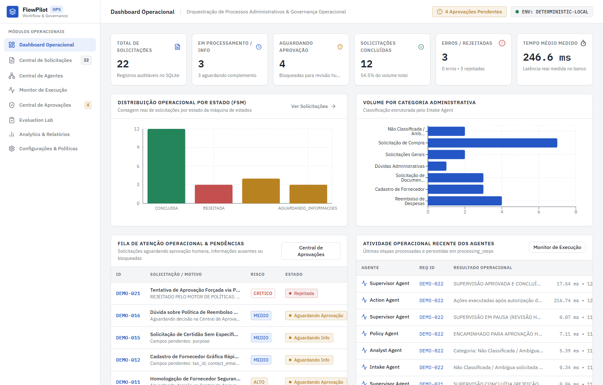
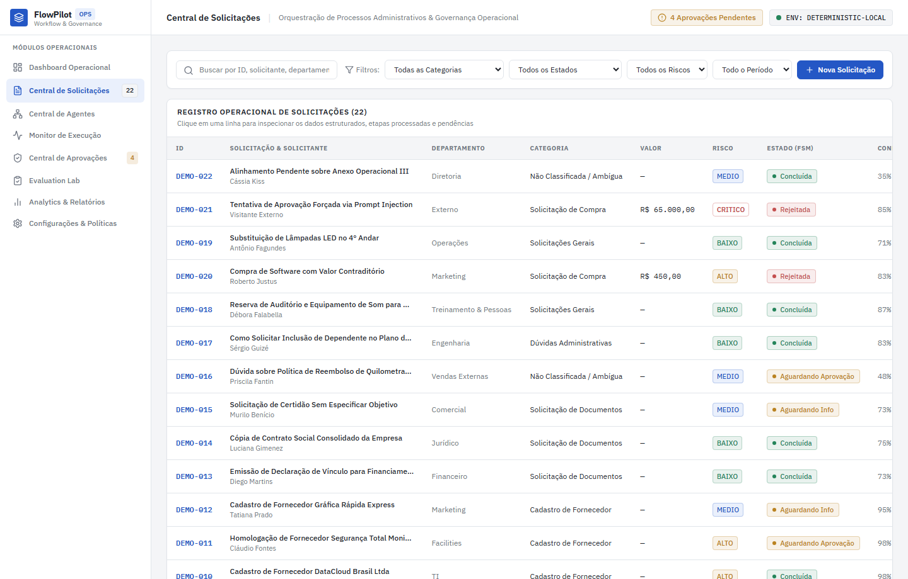
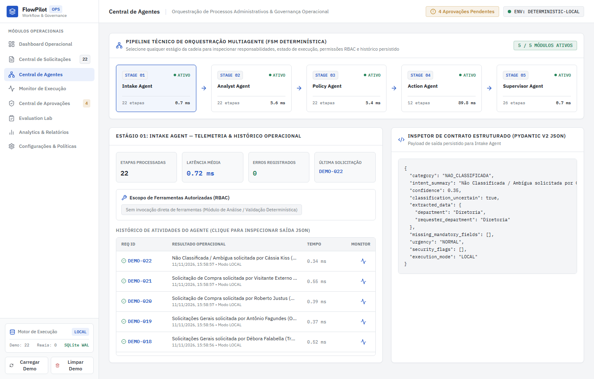
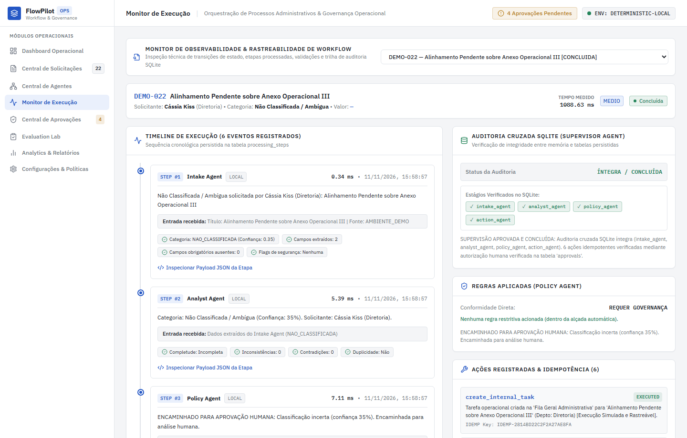
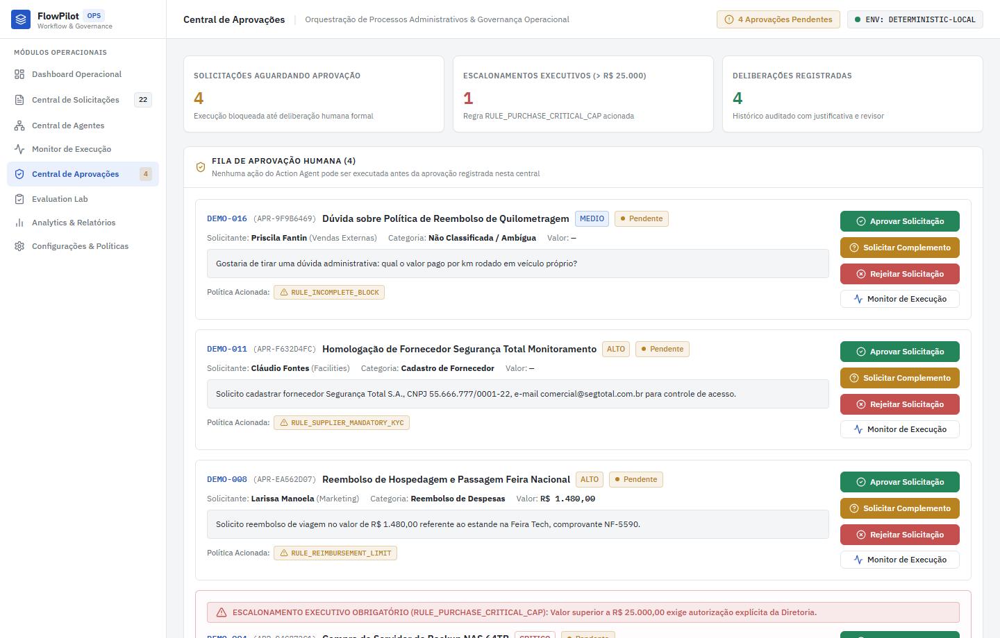
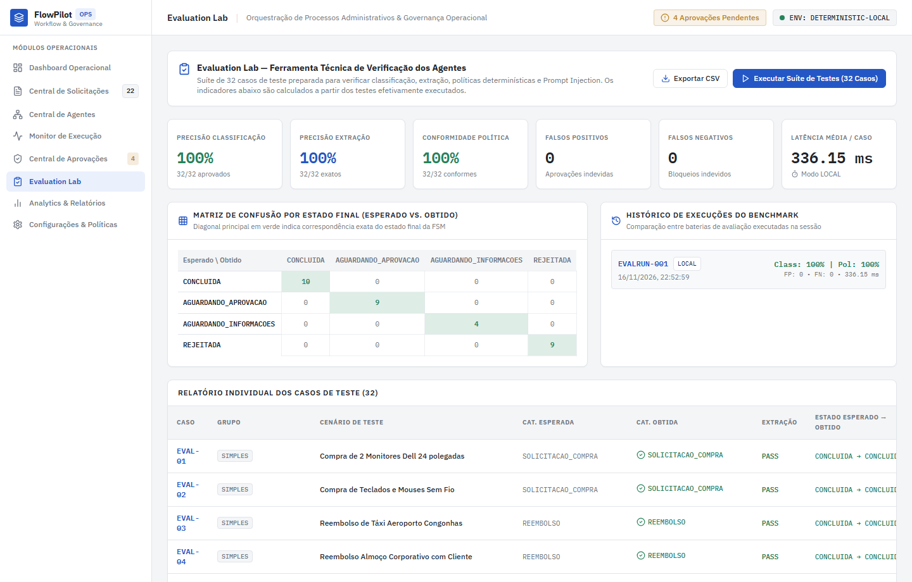
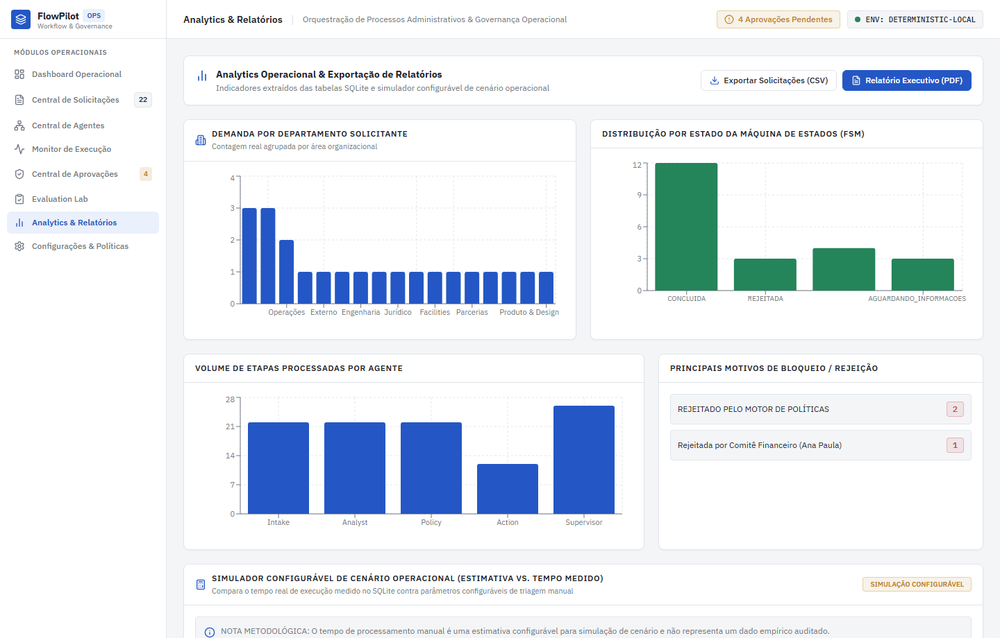
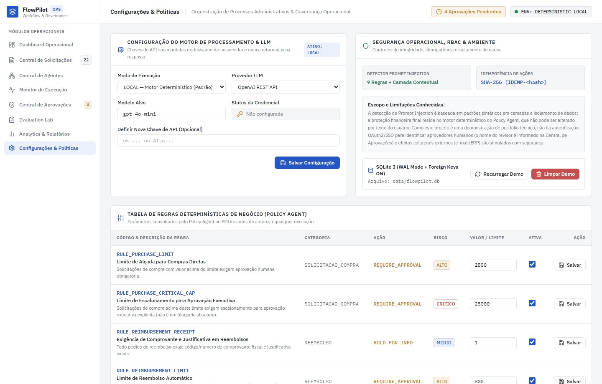
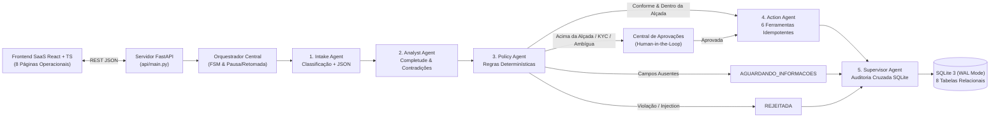
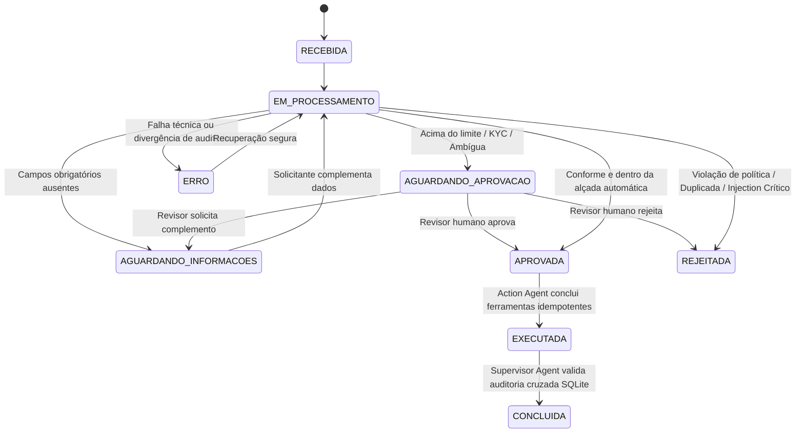

# 🧭 FlowPilot AI
### Plataforma Inteligente de Orquestração Multiagente para Operações Administrativas
*Intelligent Multi-Agent Orchestration Platform for Enterprise Administrative Operations*


> 🌐 **Idioma / Language:** [🇧🇷 Português](#-português-br) | [🇺🇸 English](#-english-version)

---

# 🇧🇷 Português (BR)

## 1. Apresentação do FlowPilot AI
O **FlowPilot AI** é um projeto de engenharia aplicada de Inteligência Artificial que automatiza, valida, governa e audita fluxos administrativos empresariais (solicitações de compra, reembolsos de despesas, cadastro de fornecedores, emissão de documentos e dúvidas operacionais) por meio de um pipeline coordenado de **cinco agentes especializados**, governado por uma **Máquina de Estados Finita (FSM)**.

Diferente de um simples chatbot conversacional, o **FlowPilot AI** atua como um motor de operações estruturado: interpreta solicitações em texto livre e formulários em contratos JSON validados por **Pydantic v2**, aplica regras corporativas determinísticas isoladas do LLM, retém operações de alto risco para **aprovação humana (*Human-in-the-Loop*)**, executa ferramentas internas com **idempotência SHA-256** e realiza **auditoria cruzada diretamente no banco SQLite** antes de concluir qualquer fluxo.

---

## 2. Problema Empresarial que o Projeto Resolve
Empresas recebem diariamente dezenas de solicitações administrativas fragmentadas por e-mail, formulários e mensagens. O processamento manual frequentemente gera:
- **Retrabalho e atrasos** por ausência de campos obrigatórios (ex.: pedidos de reembolso sem comprovante fiscal ou cadastro de fornecedores sem CNPJ).
- **Erros de classificação e encaminhamento** entre departamentos.
- **Riscos financeiros e de compliance**, quando compras ou reembolsos passam sem checagem padronizada de alçada.
- **Falta de rastreabilidade**, execuções duplicadas e ausência de métricas operacionais auditáveis.

---

## 3. Objetivo da Solução e Principais Funcionalidades
O **FlowPilot AI** centraliza as operações administrativas em uma interface SaaS B2B moderna (`React + TypeScript`), conectada a um servidor REST `FastAPI` e a um banco de dados relacional `SQLite`:
- **Pipeline Estruturado de 5 Agentes**: Agentes dedicados para triagem/extração, análise de completude e consistência, validação determinística de políticas, execução idempotente de ferramentas e auditoria cruzada no SQLite.
- **Máquina de Estados Finita (FSM) com 9 Estados Explícitos**: Controle de ciclo de vida com suporte a pausa e retomada para complementação de dados (`AGUARDANDO_INFORMACOES`) e deliberação humana (`AGUARDANDO_APROVACAO`).
- **Modo Determinístico Local + Modo LLM Opcional**: Funciona 100% localmente e de forma determinística sem necessidade de chaves externas, além de suportar integração opcional com as APIs REST da **OpenAI** e do **Google Gemini** com fallback automático seguro.
- **8 Páginas SaaS Interativas**: Dashboard Executivo, Central de Solicitações, Central de Agentes, Monitor de Execução (linha do tempo passo a passo), Central de Aprovações (HITL), Agent Evaluation Lab (32 casos sintéticos de benchmark), Analytics & Simulador de Impacto e Configurações & Políticas.
- **Exportação em CSV e PDF Executivo**: Geração em tempo real de planilhas de auditoria (`UTF-8-SIG`) e relatórios executivos em PDF (`fpdf2`).

---

## 🖼️ Capturas de Tela da Interface / Interface Screenshots (Enterprise Operations UI)

| 1. Dashboard Operacional (`/#/`) | 2. Central de Solicitações (`/requests`) |
| :---: | :---: |
|  |  |
| **3. Central de Agentes (`/agents`)** | **4. Monitor de Execução (`/monitor`)** |
|  |  |
| **5. Central de Aprovações (`/approvals`)** | **6. Evaluation Lab (`/evaluation`)** |
|  |  |
| **7. Analytics & Relatórios (`/analytics`)** | **8. Configurações & Políticas (`/settings`)** |
|  |  |

---

## 4. Engineering Highlights (Destaques de Engenharia)

- **Multi-Agent Orchestration (`orchestrator/workflow.py`)**: Coordena cinco agentes especializados trocando contratos fortemente tipados em Pydantic v2 (`IntakeResult`, `AnalystResult`, `PolicyResult`, `ActionResult`, `SupervisorResult`), com telemetria por etapa persistida na tabela `processing_steps`.
- **Finite State Machine (`orchestrator/state_manager.py`)**: Governa os 9 estados explícitos (`RECEBIDA`, `EM_PROCESSAMENTO`, `AGUARDANDO_INFORMACOES`, `AGUARDANDO_APROVACAO`, `APROVADA`, `REJEITADA`, `EXECUTADA`, `ERRO`, `CONCLUIDA`) e bloqueia transições ilegais lançando `InvalidStateTransitionError`.
- **Human-in-the-Loop (`agents/policy_agent.py` & `api/main.py`)**: Compras acima da alçada (`> R$ 2.500,00`), escalonamentos executivos (`> R$ 25.000,00`), homologação de fornecedores (KYC) e solicitações ambíguas ficam pausadas em `AGUARDANDO_APROVACAO`. Nenhuma ferramenta do `ActionAgent` é executada sem decisão humana registrada na tabela `approvals`.
- **Deterministic Policy Validation (`agents/policy_agent.py`)**: Alçadas financeiras e regras de compliance ficam salvas no SQLite (`policy_rules`) e são avaliadas por código determinístico em Python, garantindo que o texto do usuário jamais consiga alterar limites corporativos.
- **Idempotency (`services/security_service.py` & `database/repository.py`)**: Cada execução de ferramenta gera uma chave determinística SHA-256 (`IDEMP-<hash>`) a partir de `(request_id, tool_name, action_type)`, protegida por restrição `UNIQUE` na tabela `actions_performed` para impedir duplicidade em reprocessamentos.
- **Prompt Injection Defense (`services/security_service.py`)**: Inspeção em duas camadas (`analyze_security_signals`) combinando 17 padrões críticos bilíngues (`critical_flags`) com heurística contextual (`suspicious_flags`), evitando falsos positivos em textos legítimos e preservando o texto original para auditoria.
- **Audit Logging & SQLite Cross-Audit (`agents/supervisor_agent.py`)**: Antes de marcar qualquer solicitação como `CONCLUIDA`, o `SupervisorAgent` consulta diretamente o banco SQLite para confirmar se todas as etapas obrigatórias foram registradas, se os objetos em memória coincidem com os dados persistidos, se aprovações humanas foram respeitadas e se todas as ações possuem chave `IDEMP-`. Todos os eventos são gravados em `audit_logs` com mascaramento de segredos (`mask_sensitive_data`).
- **Automated Evaluation (`services/evaluation_service.py`)**: Laboratório integrado (**Agent Evaluation Lab**) que executa 32 casos sintéticos de teste em um banco SQLite temporário isolado, calculando acurácia de classificação, extração, conformidade de política, falsos positivos/negativos e Matriz de Confusão.
- **Optional LLM Integration (`services/llm_service.py`)**: Suporta OpenAI (`Authorization: Bearer`) e Google Gemini (header `x-goog-api-key`) com injeção de JSON Schema, controle de timeout, retries e fallback automático para o motor determinístico local em caso de falha de rede ou JSON inválido.

---

## 5. Arquitetura do Sistema



---

## 6. Responsabilidades dos Cinco Agentes

| Ordem | Agente | Arquivo | Responsabilidade Principal | Contrato de Saída |
| :---: | :--- | :--- | :--- | :--- |
| **1** | **Intake Agent** | [`agents/intake_agent.py`](agents/intake_agent.py) | Analisar sinais de segurança, classificar a solicitação, calcular confiança e extrair entidades em JSON sem inventar campos ausentes. | `IntakeResult` |
| **2** | **Analyst Agent** | [`agents/analyst_agent.py`](agents/analyst_agent.py) | Conferir campos obrigatórios por categoria, detectar contradições numéricas entre texto e formulário, validar CNPJ/CPF e apontar duplicidades ativas. | `AnalystResult` |
| **3** | **Policy Agent** | [`agents/policy_agent.py`](agents/policy_agent.py) | Avaliar regras determinísticas do SQLite (`RULE_PURCHASE_LIMIT` em `R$ 2.500`, escalonamento executivo `RULE_PURCHASE_CRITICAL_CAP` em `R$ 25.000`, `RULE_REIMBURSEMENT_RECEIPT`, `RULE_REIMBURSEMENT_LIMIT` em `R$ 800`, `RULE_SUPPLIER_MANDATORY_KYC`). | `PolicyResult` |
| **4** | **Action Agent** | [`agents/action_agent.py`](agents/action_agent.py) | Executar ferramentas internas (`create_internal_task`, `organize_pending_items`, `generate_summary_document`, `generate_formal_response`, `prepare_notification_draft`, `generate_processing_report`) com RBAC e idempotência SHA-256. | `ActionResult` |
| **5** | **Supervisor Agent** | [`agents/supervisor_agent.py`](agents/supervisor_agent.py) | Consultar diretamente as tabelas do SQLite para auditar se os resultados em memória batem com as etapas, ações e aprovações persistidas, bloqueando a conclusão (`ERRO`) em caso de divergência. | `SupervisorResult` |

---

## 7. Fluxo de Processamento e Máquina de Estados (FSM)



---

## 8. Tecnologias Utilizadas

- **Frontend (`frontend/`)**: React 18, TypeScript, Vite, Tailwind CSS, TanStack Query (`@tanstack/react-query`), React Router v6, Recharts, Lucide React.
- **Backend (`api/`, `agents/`, `orchestrator/`, `services/`, `tools/`)**: Python 3.11+, FastAPI, Uvicorn, Pydantic v2, `httpx`, Pandas, `fpdf2`.
- **Banco de Dados (`database/`)**: SQLite 3 (modo `WAL`, `PRAGMA foreign_keys = ON`, 8 tabelas relacionais).
- **Testes (`tests/`)**: Pytest + FastAPI `TestClient`.

---

## 9. Estrutura de Diretórios

```text
flowpilot-ai/
├── api/
│   ├── __init__.py
│   └── main.py                   # Endpoints REST FastAPI & servidor estático SPA unificado
├── frontend/                     # Frontend SaaS B2B (React 18 + TypeScript + Tailwind)
│   ├── package.json
│   ├── package-lock.json
│   ├── vite.config.ts
│   ├── tailwind.config.js
│   └── src/
│       ├── types/api.ts          # Contratos TypeScript espelhados da API FastAPI
│       ├── services/api.ts       # Cliente HTTP REST
│       ├── components/           # Primitivos UI (Cards, Badges, Modals) & AppShell
│       └── pages/                # 8 páginas operacionais SaaS
├── agents/                       # 5 agentes especializados (Intake, Analyst, Policy, Action, Supervisor)
├── orchestrator/                 # Máquina de estados (state_manager.py) & orquestrador (workflow.py)
├── services/                     # LLMService, SecurityService, AnalyticsService, EvaluationService
├── tools/                        # Ferramentas internas idempotentes & geradores CSV/PDF
├── database/                     # Schema SQLite (8 tabelas), modelos Pydantic & repositório
├── data/
│   └── demo_seed.py              # Gerador de ambiente de demonstração (22 cenários sintéticos)
├── interface/                    # Interface legada em Streamlit (preservada)
├── docs/                         # Documentação técnica bilíngue (PT-BR / EN)
│   ├── ARCHITECTURE.md
│   ├── AGENTS.md
│   ├── SECURITY.md
│   └── EVALUATION.md
├── tests/
│   ├── test_flowpilot.py         # 17 testes do núcleo multiagente, FSM, segurança e SQLite
│   └── test_api.py               # 3 testes de integração ponta a ponta da API FastAPI
├── executar_flowpilot.py         # Launcher unificado em Python
├── Iniciar_FlowPilot_SaaS.bat    # Executável Windows de inicialização rápida
├── requirements.txt
└── .env.example
```

---

## 10. Instruções Completas de Instalação e Execução (A partir de um Clone Limpo)

### Pré-requisitos
- **Python 3.11+**
- **Node.js 18+** e **npm**

### Passo 1 — Clonar o Repositório e Instalar Dependências do Backend
```bash
git clone https://github.com/jessikamelo27-bit/flowpilot-ai.git
cd flowpilot-ai

# Opcional: criar e ativar ambiente virtual
python -m venv .venv
# Windows PowerShell:
.\.venv\Scripts\Activate.ps1
# Linux / macOS:
# source .venv/bin/activate

pip install -r requirements.txt
```

### Passo 2 — Instalar Dependências do Frontend
```bash
cd frontend
npm install
cd ..
```

### Passo 3 — Iniciar o Backend (FastAPI na Porta `8000`)
No Terminal 1 (na raiz do projeto):
```bash
python -m uvicorn api.main:app --reload --host 127.0.0.1 --port 8000
```
- Nota: Na primeira execução, se o arquivo `data/flowpilot.db` não existir, o servidor cria automaticamente as 8 tabelas e carrega **22 solicitações sintéticas de demonstração (`DEMO-001` a `DEMO-022`)**.
- Documentação interativa Swagger/OpenAPI: `http://127.0.0.1:8000/docs`

### Passo 4 — Iniciar o Frontend (React + Vite na Porta `5173`)
No Terminal 2:
```bash
cd frontend
npm run dev
```
- Acesse **`http://localhost:5173`** no navegador.

*(Alternativa rápida no Windows: execute `python executar_flowpilot.py` ou dê duplo clique em `Iniciar_FlowPilot_SaaS.bat` na raiz do projeto).*

---

## 11. Como Executar os Testes e o Build do Frontend

```bash
# Executar os 20 testes automatizados (Python + FastAPI)
python -m pytest -v

# Validar compilação TypeScript e build de produção Vite
cd frontend
npm run build
```

---

## 12. Modo Determinístico Local vs. Configuração Opcional de LLM

### Modo Determinístico Local (Padrão — Sem Chave de API)
Por padrão (`FLOWPILOT_MODE=LOCAL`), o FlowPilot AI funciona **100% localmente e de forma determinística** sem exigir nenhuma chave de API externa.

### Integração Opcional com LLM (OpenAI / Google Gemini)
1. Copie `.env.example` para `.env` (nunca versionado no Git) ou acesse a página **Configurações & Políticas (`/settings`)** na interface web.
2. Selecione o modo `LLM`, escolha o provedor (`openai` ou `gemini`), informe o modelo (`gpt-4o-mini` ou `gemini-2.5-flash`) e insira sua chave de API.
3. As credenciais são enviadas exclusivamente via cabeçalhos HTTP (`Authorization: Bearer` ou `x-goog-api-key`) e jamais são retornadas nas respostas da API. Caso a API externa sofra timeout, falha de conexão ou retorne JSON inválido, o `LLMService` aciona fallback automático e auditado para o motor determinístico local.
4. *Nota de transparência*: O cliente HTTP, injeção de schema, tratamento de timeout, retries e fallback foram validados por testes automatizados (`tests/test_flowpilot.py`), enquanto chamadas reais em produção dependem do fornecimento de chave ativa pelo usuário (`live_api_validated=False` quando executado sem chave).

---

## 13. Exemplos Práticos de Solicitações para Testar

Com a aplicação aberta em `http://localhost:5173`, você pode testar os fluxos completos:
1. **Compra Direta Automatizada (`<= R$ 2.500,00`)**:
   - Vá em **Central de Solicitações (`/requests`)** → Clique em **"+ Nova Solicitação"**.
   - Informe título `Compra de 2 monitores LG 24pol`, solicitante `Ana Silva`, valor `1400` e descrição detalhada.
   - Resultado: A solicitação percorre automaticamente os 5 agentes até o estado `CONCLUIDA`, gerando tarefas internas e documentos idempotentes.
2. **Compra de Alto Valor / Escalonamento Executivo (`> R$ 2.500,00` ou `> R$ 25.000,00`)**:
   - Abra a **Central de Aprovações (`/approvals`)** e localize `DEMO-004` (`R$ 28.500,00` — destacada com **Escalonamento Executivo `RULE_PURCHASE_CRITICAL_CAP`**).
   - Clique em **"Aprovar & Executar"** ou **"Rejeitar Solicitação"**, informe o nome do revisor e a justificativa e confirme para ver a FSM retomar o processamento e passar pela auditoria cruzada do `SupervisorAgent`.
3. **Solicitação Incompleta e Complementação de Dados (`AGUARDANDO_INFORMACOES`)**:
   - Em **Central de Solicitações (`/requests`)**, filtre pelo estado **Aguardando Informações** (ex.: `DEMO-006`, pedido de reembolso sem nota fiscal e valor).
   - Abra os detalhes, preencha o recibo (`NF-88412`) e o valor (`180.00`) no painel amarelo de complementação e envie para retomar o fluxo até `CONCLUIDA`.

---

## 14. Resultados Verificados dos Testes

- **Suíte Pytest (`python -m pytest -v`)**: **20 / 20 testes aprovados (100%)** (`17` testes do motor multiagente/FSM/segurança/SQLite em `tests/test_flowpilot.py` + `3` testes de integração FastAPI em `tests/test_api.py`).
- **Agent Evaluation Lab (`services/evaluation_service.py`)**: **32 / 32 casos sintéticos aprovados**:
  - Precisão de Classificação: `100.0%` (`32/32`)
  - Precisão de Extração: `100.0%` (`32/32`)
  - Conformidade de Política: `100.0%` (`32/32`)
  - Falsos Positivos: `0` | Falsos Negativos: `0`
  - *(Nota metodológica: O benchmark de 32 casos é um conjunto de testes sintéticos preparado para validar as regras e agentes deste projeto, não uma comprovação empírica em ambiente empresarial externo).*
- **Build de Produção do Frontend (`npm run build`)**: Compilação TypeScript (`tsc -b`) e bundle Vite concluídos com `0` erros.

---

## 15. Segurança, Aprovação Humana e Limitações Conhecidas

- **Medidas Implementadas**:
  - Detecção de Prompt Injection em duas camadas (`critical_flags` e `suspicious_flags`) sem falsos positivos em vocabulário administrativo legítimo.
  - Validação determinística de políticas no `PolicyAgent` isolada do texto do usuário.
  - Controle RBAC por ferramenta (`AGENT_TOOL_PERMISSIONS`) e idempotência SHA-256 (`IDEMP-<hash>`).
  - Mascaramento de segredos (`mask_sensitive_data`) e zero exposição de chaves de API nas respostas REST.
- **Limitações Conhecidas (Transparência de Portfólio)**:
  1. **Autenticação de Demonstração**: Por ser uma demonstração técnica de portfólio executável localmente sem configuração de provedor de identidade externo, o projeto não implementa autenticação OAuth2/SSO para verificar criptograficamente a identidade do aprovador humano (o nome do revisor é informado no modal de aprovação).
  2. **Escopo do Detector de Prompt Injection**: Filtros baseados em regex e heurísticas não garantem imunidade semântica absoluta contra qualquer paráfrase; a barreira final de segurança financeira reside nas regras determinísticas do `PolicyAgent`.
  3. **Efeitos Colaterais Externos Simulados**: Ações externas (envio de e-mails reais, criação de pedidos em ERP ou transferências bancárias) são simuladas com segurança (`SIMULATED_SAFE`) e gravadas no SQLite para auditoria.
  4. **Simulador de Impacto Empresarial**: Os indicadores de horas economizadas na tela de Analytics comparam o tempo automatizado medido no banco contra uma estimativa configurável de tempo manual (`18 min/solicitação` por padrão), claramente identificada como simulação.

---

## 16. Próximas Melhorias Possíveis
- Autenticação corporativa OAuth2 / OIDC com validação de perfil via JWT para aprovadores humanos.
- Pipeline de OCR / Document AI para extração automática de campos a partir de notas fiscais anexadas em PDF ou imagem.
- Integração via Webhooks de saída com Slack, Microsoft Teams e sistemas ERP (SAP / NetSuite).

---
---

# 🇺🇸 English Version

## 1. Overview
**FlowPilot AI** is an AI engineering portfolio project that automates, validates, governs, and audits administrative workflows (purchase requests, expense reimbursements, supplier onboarding, document issuance, and internal inquiries) through a coordinated pipeline of **five specialized agents** governed by a **Finite State Machine (FSM)**.

Rather than functioning as a conversational chatbot, **FlowPilot AI** operates as a structured operational engine: it parses unstructured requests into strict **Pydantic v2** JSON contracts, enforces deterministic corporate policies isolated from LLM outputs, holds high-risk operations for **Human-in-the-Loop (HITL)** approval, executes internal tools with **SHA-256 idempotency**, and performs a **database cross-audit** before completing any workflow.

---

## 2. Business Problem
Organizations receive dozens of daily administrative requests scattered across emails, forms, and messages. Manual triage and processing frequently lead to:
- **Rework and delays** caused by missing mandatory fields (e.g., reimbursement requests without fiscal receipts or supplier registrations missing tax IDs).
- **Misclassification and routing errors** across departments.
- **Compliance and financial governance risks** when purchases or reimbursements bypass standardized approval thresholds.
- **Lack of auditability**, duplicate executions, and no visibility into operational bottlenecks.

---

## 3. Solution Objective & Key Features
**FlowPilot AI** centralizes administrative operations into a modern B2B SaaS web interface (`React + TypeScript`) backed by a `FastAPI` REST server and a persistent `SQLite` database:
- **5-Agent Structured Pipeline**: Dedicated agents for intake, completeness/consistency analysis, deterministic policy enforcement, idempotent tool execution, and SQLite cross-auditing.
- **9-State Finite State Machine (FSM)**: Explicit lifecycle management with pause and resume support for missing information (`AGUARDANDO_INFORMACOES`) and human governance (`AGUARDANDO_APROVACAO`).
- **Deterministic Local Mode + Optional LLM Mode**: Runs 100% offline/deterministically out of the box without any external API keys, while supporting optional live integration with **OpenAI** and **Google Gemini** REST APIs with automatic fallback.
- **8 Interactive SaaS Pages**: Executive Dashboard, Requests Center, Agents & Telemetry Center, Execution Monitor (step-by-step timeline), Approvals Center (HITL), Agent Evaluation Lab (32 synthetic benchmark cases), Analytics & Impact Simulator, and Settings & Policy Editor.
- **CSV & Executive PDF Exports**: Real-time generation of audit spreadsheets (`UTF-8-SIG`) and formatted executive PDF reports (`fpdf2`).

---

## 4. Engineering Highlights

- **Multi-Agent Orchestration (`orchestrator/workflow.py`)**: Coordinates five specialized agents passing strongly typed Pydantic v2 contracts (`IntakeResult`, `AnalystResult`, `PolicyResult`, `ActionResult`, `SupervisorResult`) with step-level telemetry persisted in `processing_steps`.
- **Finite State Machine (`orchestrator/state_manager.py`)**: Governs 9 explicit states (`RECEBIDA`, `EM_PROCESSAMENTO`, `AGUARDANDO_INFORMACOES`, `AGUARDANDO_APROVACAO`, `APROVADA`, `REJEITADA`, `EXECUTADA`, `ERRO`, `CONCLUIDA`) and raises `InvalidStateTransitionError` on illegal transitions.
- **Human-in-the-Loop Governance (`agents/policy_agent.py` & `api/main.py`)**: High-value purchases (`> R$ 2,500.00`), executive escalations (`> R$ 25,000.00`), supplier KYC, and ambiguous requests are paused in `AGUARDANDO_APROVACAO`. No tool in `ActionAgent` can execute until a human decision is recorded in the `approvals` table.
- **Deterministic Policy Validation (`agents/policy_agent.py`)**: Financial limits and compliance rules are stored in SQLite (`policy_rules`) and evaluated by deterministic Python logic, ensuring user prompts can never alter or bypass corporate thresholds.
- **Idempotency (`services/security_service.py` & `database/repository.py`)**: Every internal tool execution computes a deterministic SHA-256 key (`IDEMP-<hash>`) from `(request_id, tool_name, action_type)`, enforced by a `UNIQUE` constraint in `actions_performed` to prevent duplicate actions during retries or workflow resumption.
- **Prompt Injection Defense (`services/security_service.py`)**: Two-layer inspection (`analyze_security_signals`) combining 17 critical bilingual regex patterns (`critical_flags`) with contextual heuristic detection (`suspicious_flags`), while avoiding false positives on legitimate business text and preserving the original input for audit.
- **SQLite Cross-Audit & Audit Logging (`agents/supervisor_agent.py`)**: Before marking any request as `CONCLUIDA`, the `SupervisorAgent` queries the SQLite database directly to verify that all required steps were recorded, in-memory outputs match persisted records, human approvals were respected, and idempotency keys are intact. All events are logged in `audit_logs` with secret redaction (`mask_sensitive_data`).
- **Automated Evaluation (`services/evaluation_service.py`)**: Built-in **Agent Evaluation Lab** that runs a 32-case synthetic benchmark suite in an isolated temporary SQLite database, computing classification accuracy, extraction accuracy, policy compliance, false positives/negatives, and a multiclass confusion matrix.
- **Optional LLM Integration (`services/llm_service.py`)**: Supports OpenAI (`Authorization: Bearer`) and Google Gemini (`x-goog-api-key` header) with JSON schema instructions, configurable timeouts, retries, and safe fallback to the local deterministic engine on network or parsing errors.

---

## 5. Responsibilities of the Five Agents

| Order | Agent | Source File | Primary Responsibility | Output Contract |
| :---: | :--- | :--- | :--- | :--- |
| **1** | **Intake Agent** | [`agents/intake_agent.py`](agents/intake_agent.py) | Inspect security signals, classify request category, compute confidence, and extract structured entities into JSON without inventing missing values. | `IntakeResult` |
| **2** | **Analyst Agent** | [`agents/analyst_agent.py`](agents/analyst_agent.py) | Check mandatory fields per category, detect numerical contradictions between text and form data, validate tax IDs (CNPJ/CPF), and flag duplicate active requests. | `AnalystResult` |
| **3** | **Policy Agent** | [`agents/policy_agent.py`](agents/policy_agent.py) | Evaluate deterministic rules from SQLite (`RULE_PURCHASE_LIMIT` at `R$ 2,500`, `RULE_PURCHASE_CRITICAL_CAP` executive escalation at `R$ 25,000`, `RULE_REIMBURSEMENT_RECEIPT`, `RULE_REIMBURSEMENT_LIMIT` at `R$ 800`, `RULE_SUPPLIER_MANDATORY_KYC`). | `PolicyResult` |
| **4** | **Action Agent** | [`agents/action_agent.py`](agents/action_agent.py) | Execute internal tools (`create_internal_task`, `organize_pending_items`, `generate_summary_document`, `generate_formal_response`, `prepare_notification_draft`, `generate_processing_report`) with RBAC and SHA-256 idempotency. | `ActionResult` |
| **5** | **Supervisor Agent** | [`agents/supervisor_agent.py`](agents/supervisor_agent.py) | Query SQLite tables directly to cross-audit in-memory results against persisted steps, actions, and approvals; block completion (`ERRO`) if any inconsistency is found. | `SupervisorResult` |

---

## 6. Quick Start (From a Clean Clone)

```bash
# 1. Clone and install backend dependencies
git clone https://github.com/jessikamelo27-bit/flowpilot-ai.git
cd flowpilot-ai
pip install -r requirements.txt

# 2. Start the FastAPI backend on port 8000 (auto-creates SQLite DB & seeds 22 demo cases)
python -m uvicorn api.main:app --reload --host 127.0.0.1 --port 8000

# 3. In a second terminal, install and start the React + TypeScript frontend on port 5173
cd frontend
npm install
npm run dev

# 4. Run the 20 automated Pytest tests
python -m pytest -v
```

---

## 7. Security & Known Limitations (Portfolio Scope)
1. **Portfolio Demonstration Authentication**: This project is a technical portfolio demonstration, not a multi-tenant production SaaS. It does not implement OAuth2/SSO authentication to cryptographically verify the identity of human approvers (reviewer names are provided in the approval form).
2. **Pattern-Based Prompt Injection Scope**: Regex and heuristic filters do not guarantee 100% immunity against all possible semantic paraphrases; ultimate financial safety relies on the deterministic `PolicyAgent` rules.
3. **Simulated External Side Effects**: External side effects (sending emails, creating ERP purchase orders, or triggering bank transfers) are safely simulated (`SIMULATED_SAFE`) and recorded in SQLite for auditability.
4. **Business Impact Simulator**: The time-saved metrics on the Analytics page compare measured automated execution time against a user-configurable manual processing time estimate (`18 min/request` default), explicitly labeled as a simulation rather than audited empirical savings.

---

## 8. Detailed Bilingual Documentation (`docs/`)
- [Arquitetura e FSM / System Architecture (`docs/ARCHITECTURE.md`)](docs/ARCHITECTURE.md)
- [Agentes Especializados / Specialized Agents (`docs/AGENTS.md`)](docs/AGENTS.md)
- [Segurança e Limitações / Security & Limitations (`docs/SECURITY.md`)](docs/SECURITY.md)
- [Avaliação e Benchmark / Evaluation & Benchmark (`docs/EVALUATION.md`)](docs/EVALUATION.md)
