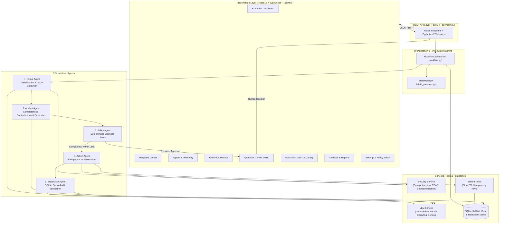
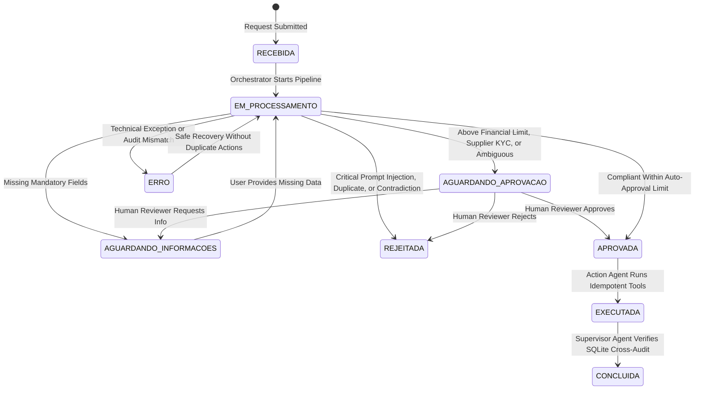

# System Architecture & Technical Decisions — FlowPilot AI

## 1. Architectural Overview
**FlowPilot AI** is engineered using a decoupled Layered Architecture that strictly separates presentation, REST transport, multi-agent orchestration, deterministic business rules, and relational persistence:

1. **Presentation Layer (`frontend/` & `interface/`)**:
   - **Primary B2B SaaS Frontend (`frontend/`)**: Built with React 18, TypeScript, Vite, Tailwind CSS, TanStack Query, React Router v6, Recharts, and Lucide React. Contains zero duplicated business logic.
   - **Legacy Streamlit Interface (`interface/`, `app.py`)**: Preserved for rapid Python-only inspection.
2. **REST API Layer (`api/main.py`)**:
   - Built with FastAPI and Pydantic v2. Exposes typed endpoints for requests, agents, human approvals, policies, evaluation benchmarks, analytics, and settings while redacting secrets and local machine paths.
3. **Central Orchestrator & Finite State Machine (`orchestrator/`)**:
   - `StateManager` (`state_manager.py`) enforces 9 explicit states and blocks illegal transitions.
   - `FlowPilotOrchestrator` (`workflow.py`) coordinates the 5 specialized agents, manages pause/resume cycles (`AGUARDANDO_APROVACAO` and `AGUARDANDO_INFORMACOES`), and records every step in SQLite.
4. **Specialized Agents (`agents/`)**:
   - Five modular agents (`IntakeAgent`, `AnalystAgent`, `PolicyAgent`, `ActionAgent`, `SupervisorAgent`) communicating exclusively via validated Pydantic v2 schemas.
5. **Core Services & Guardrails (`services/`)**:
   - `LLMService` (`llm_service.py`): Supports deterministic `LOCAL` mode and optional external `LLM` mode (OpenAI & Google Gemini REST APIs) with JSON schema injection, timeouts, retries, and automatic deterministic fallback.
   - `security_service.py`: Two-layer Prompt Injection detection (`critical_flags` and `suspicious_flags`), least-privilege tool RBAC, SHA-256 idempotency key generation, and secret masking.
   - `AnalyticsService` & `EvaluationService`: Real SQLite telemetry aggregation, configurable business impact simulation, and a 32-case automated benchmark suite.
6. **Internal Tools (`tools/`) & Relational Storage (`database/`)**:
   - Six idempotent internal tools (`task_tools.py`, `document_tools.py`, `report_tools.py`) and an 8-table SQLite database running in `WAL` mode with `PRAGMA foreign_keys = ON`.

---

## 2. System Architecture Diagram

---

## 3. Finite State Machine (FSM) Diagram

---

## 4. Key Engineering Decisions
- **Custom FSM Orchestrator vs. Heavyweight Frameworks**: Financial and administrative workflows require deterministic branching, pause/resume persistence across human review cycles, and strict database cross-auditing. Implementing `FlowPilotOrchestrator` + `StateManager` directly in Python provides full transparency and zero hidden prompt mutations.
- **Deterministic Policy Engine Isolated from LLM Output**: Even when operating in `LLM` mode, the language model only assists with classification and entity extraction. All financial limits (`R$ 2,500.00` auto-purchase limit, `R$ 25,000.00` executive escalation threshold, `R$ 800.00` reimbursement limit) are evaluated by deterministic Python code in `PolicyAgent` reading from the `policy_rules` SQLite table.
- **Database-Backed Supervisor Cross-Audit**: `SupervisorAgent` queries the SQLite repository directly (`requests`, `processing_steps`, `actions_performed`, `approvals`) to verify that in-memory agent results match persisted records and that no tool was executed prior to required human approval.
