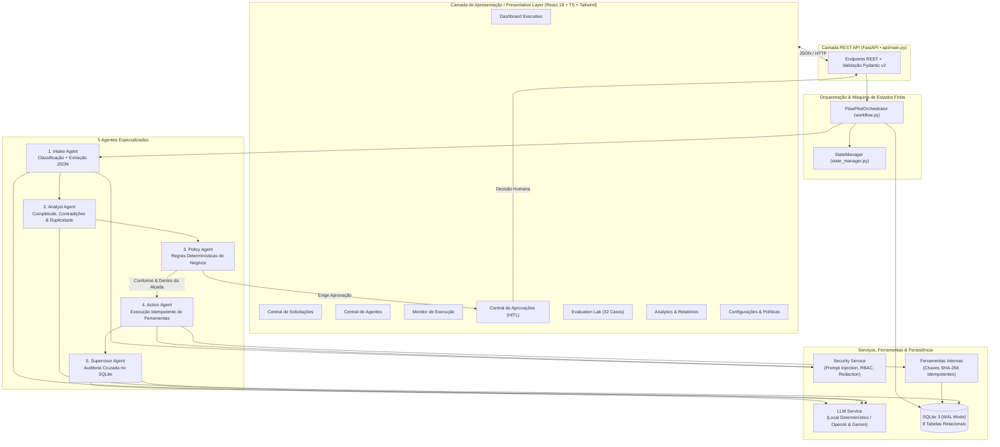
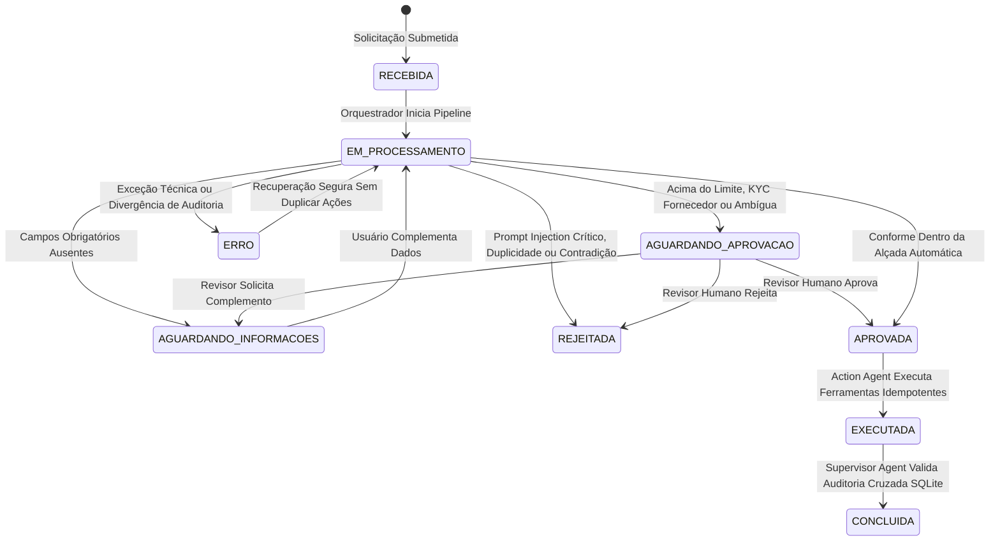

# Arquitetura do Sistema & Decisões Técnicas / System Architecture & Technical Decisions — FlowPilot AI

> 🌐 **Idioma / Language:** [🇧🇷 Português](#-português-br) | [🇺🇸 English](#-english)

---

# 🇧🇷 Português (BR)

## 1. Visão Geral da Arquitetura
O **FlowPilot AI** foi projetado com uma arquitetura em camadas desacopladas (Layered Architecture) que separa estritamente a apresentação, o transporte REST, a orquestração multiagente, as regras de negócio determinísticas e a persistência relacional:

1. **Camada de Apresentação (`frontend/` & `interface/`)**:
   - **Frontend SaaS B2B Principal (`frontend/`)**: Construído com React 18, TypeScript, Vite, Tailwind CSS, TanStack Query, React Router v6, Recharts e Lucide React. Não contém nenhuma regra de negócio duplicada.
   - **Interface Legada em Streamlit (`interface/`, `app.py`)**: Preservada para inspeção rápida somente em Python.
2. **Camada de API REST (`api/main.py`)**:
   - Construída com FastAPI e Pydantic v2. Expõe endpoints tipados para solicitações, agentes, aprovações humanas, políticas, benchmark de avaliação, analytics e configurações, ocultando segredos e caminhos locais da máquina.
3. **Orquestrador Central & Máquina de Estados Finita (`orchestrator/`)**:
   - `StateManager` (`state_manager.py`) governa os 9 estados explícitos e bloqueia transições ilegais.
   - `FlowPilotOrchestrator` (`workflow.py`) coordena os 5 agentes especializados, gerencia os ciclos de pausa e retomada (`AGUARDANDO_APROVACAO` e `AGUARDANDO_INFORMACOES`) e registra cada etapa no SQLite.
4. **Agentes Especializados (`agents/`)**:
   - Cinco agentes modulares (`IntakeAgent`, `AnalystAgent`, `PolicyAgent`, `ActionAgent`, `SupervisorAgent`) comunicando-se exclusivamente por contratos Pydantic v2 validados.
5. **Serviços Centrais & Guardrails (`services/`)**:
   - `LLMService` (`llm_service.py`): Suporta o modo determinístico `LOCAL` e o modo opcional `LLM` (APIs REST da OpenAI e Google Gemini) com injeção de JSON Schema, timeouts, retries e fallback determinístico automático.
   - `security_service.py`: Detecção de Prompt Injection em duas camadas (`critical_flags` e `suspicious_flags`), RBAC de privilégio mínimo por ferramenta, geração de chave de idempotência SHA-256 e mascaramento de segredos.
   - `AnalyticsService` & `EvaluationService`: Agregação real de telemetria do SQLite, simulador configurável de impacto empresarial e suíte automatizada de benchmark com 32 casos sintéticos.
6. **Ferramentas Internas (`tools/`) & Persistência Relacional (`database/`)**:
   - Seis ferramentas internas idempotentes (`task_tools.py`, `document_tools.py`, `report_tools.py`) e banco SQLite com 8 tabelas operando em modo `WAL` com `PRAGMA foreign_keys = ON`.

---

## 2. Diagrama de Arquitetura do Sistema

---

## 3. Diagrama da Máquina de Estados Finita (FSM)

---

## 4. Decisões Técnicas Principais
- **Orquestrador FSM Próprio vs. Frameworks Genéricos**: Fluxos administrativos e financeiros exigem ramificação determinística, persistência de pausa/retomada entre ciclos de revisão humana e auditoria cruzada estrita no banco de dados. Implementar `FlowPilotOrchestrator` + `StateManager` diretamente em Python garante total transparência e zero mutações ocultas de prompt.
- **Motor Determinístico de Políticas Isolado do LLM**: Mesmo quando operando no modo `LLM`, o modelo de linguagem atua apenas na classificação e extração estruturada. Todos os limites financeiros (`R$ 2.500,00` para aprovação direta de compras, `R$ 25.000,00` para escalonamento executivo, `R$ 800,00` para reembolsos) são avaliados por código Python determinístico no `PolicyAgent` consultando a tabela `policy_rules` do SQLite.
- **Auditoria Cruzada no SQLite pelo Supervisor**: O `SupervisorAgent` consulta diretamente o repositório SQLite (`requests`, `processing_steps`, `actions_performed`, `approvals`) para verificar se os resultados em memória coincidem com os registros persistidos e se nenhuma ferramenta foi executada antes da aprovação humana obrigatória.

---
---

# 🇺🇸 English

## 1. Architectural Overview
**FlowPilot AI** is engineered using a decoupled Layered Architecture that strictly separates presentation, REST transport, multi-agent orchestration, deterministic business rules, and relational persistence:

1. **Presentation Layer (`frontend/` & `interface/`)**:
   - **Primary B2B SaaS Frontend (`frontend/`)**: Built with React 18, TypeScript, Vite, Tailwind CSS, TanStack Query, React Router v6, Recharts, and Lucide React. Contains zero duplicated business logic.
   - **Legacy Streamlit Interface (`interface/`, `app.py`)**: Preserved for rapid Python-only inspection.
2. **REST API Layer (`api/main.py`)**:
   - Built with FastAPI and Pydantic v2. Exposes typed endpoints for requests, agents, human approvals, policies, evaluation benchmarks, analytics, and settings while redacting secrets and local machine paths.
3. **Central Orchestrator & Finite State Machine (`orchestrator/`)**:
   - `StateManager` (`state_manager.py`) enforces 9 explicit states and blocks illegal transitions.
   - `FlowPilotOrchestrator` (`workflow.py`) coordinates the 5 specialized agents, manages pause/resume cycles (`AGUARDANDO_APROVACAO` and `AGUARDANDO_INFORMACOES`), and records every step in SQLite.
4. **Specialized Agents (`agents/`)**:
   - Five modular agents (`IntakeAgent`, `AnalystAgent`, `PolicyAgent`, `ActionAgent`, `SupervisorAgent`) communicating exclusively via validated Pydantic v2 schemas.
5. **Core Services & Guardrails (`services/`)**:
   - `LLMService` (`llm_service.py`): Supports deterministic `LOCAL` mode and optional external `LLM` mode (OpenAI & Google Gemini REST APIs) with JSON schema injection, timeouts, retries, and automatic deterministic fallback.
   - `security_service.py`: Two-layer Prompt Injection detection (`critical_flags` and `suspicious_flags`), least-privilege tool RBAC, SHA-256 idempotency key generation, and secret masking.
   - `AnalyticsService` & `EvaluationService`: Real SQLite telemetry aggregation, configurable business impact simulation, and a 32-case automated benchmark suite.
6. **Internal Tools (`tools/`) & Relational Storage (`database/`)**:
   - Six idempotent internal tools (`task_tools.py`, `document_tools.py`, `report_tools.py`) and an 8-table SQLite database running in `WAL` mode with `PRAGMA foreign_keys = ON`.

---

## 2. Key Engineering Decisions
- **Custom FSM Orchestrator vs. Heavyweight Frameworks**: Financial and administrative workflows require deterministic branching, pause/resume persistence across human review cycles, and strict database cross-auditing. Implementing `FlowPilotOrchestrator` + `StateManager` directly in Python provides full transparency and zero hidden prompt mutations.
- **Deterministic Policy Engine Isolated from LLM Output**: Even when operating in `LLM` mode, the language model only assists with classification and entity extraction. All financial limits (`R$ 2,500.00` auto-purchase limit, `R$ 25,000.00` executive escalation threshold, `R$ 800.00` reimbursement limit) are evaluated by deterministic Python code in `PolicyAgent` reading from the `policy_rules` SQLite table.
- **Database-Backed Supervisor Cross-Audit**: `SupervisorAgent` queries the SQLite repository directly (`requests`, `processing_steps`, `actions_performed`, `approvals`) to verify that in-memory agent results match persisted records and that no tool was executed prior to required human approval.
